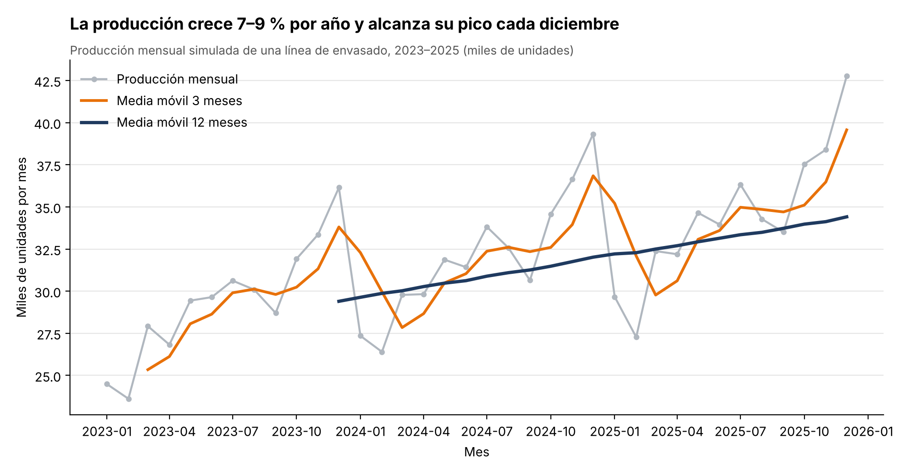

# Actividad Opcional – Semana 11: Análisis de una serie de tiempo

**Estudiante:** Isabella Ramos Betancourt  
**Universidad:** Corporación Universitaria del Huila – CORHUILA (Facultad de Ingeniería, Ingeniería Industrial)  
**Asignatura:** Ciencia de Datos – Código 69109 · Pénsum 40D · Grupo 1  
**Docente:** Jesús Ariel Gonzáles Bonilla  
**Periodo:** 2026-B · Unidad 3 – Corte 3  
**Fecha:** 7 de noviembre de 2026  

---

## 1. Introducción

Gran parte de los datos industriales tiene una dimensión temporal: la producción diaria de una línea, la temperatura de un equipo por hora o las ventas de cada mes. Una serie de tiempo es una secuencia de valores ordenados por fecha que permite ver cómo evoluciona un fenómeno y, a partir de esa historia, anticipar su comportamiento. Para interpretarla conviene separar tres componentes: la tendencia (la dirección de largo plazo), la estacionalidad (los patrones que se repiten en cada periodo) y el ruido (la variación aleatoria) (Hyndman & Athanasopoulos, 2021).

Esta actividad aplica esa lógica con pandas a una serie diaria de producción de una línea de envasado. El documento describe la carga de los datos con la fecha como índice (sección 2), la agregación mensual y el cálculo de las medias móviles (sección 3), la interpretación de la tendencia y la estacionalidad (sección 4), las limitaciones del análisis (sección 5) y una conclusión (sección 6), que conecta el resultado con la planeación del mantenimiento.

> **Nota sobre los datos:** las cifras son **ilustrativas (simuladas)** y se crearon únicamente para esta actividad; no corresponden a registros de una empresa real. Los scripts `generar_datos.py` y `analisis_serie.py`, incluidos en esta carpeta, reproducen el archivo `produccion_diaria.csv` y el gráfico `grafico_serie.png`.

---

## 2. Carga de la serie con la fecha como índice

La serie contiene **1 096 registros diarios** (del 1 de enero de 2023 al 31 de diciembre de 2025) con dos columnas: `fecha` y `unidades` (unidades envasadas ese día). Se simuló con una tendencia creciente, un factor estacional por mes (más producción hacia fin de año), una menor producción los domingos y ruido aleatorio con semilla fija, de modo que el resultado sea reproducible.

El paso más importante de la carga es que la fecha se lea como **fecha y no como texto**; de lo contrario no sería posible ordenar ni agregar por periodo. Por eso se usa `parse_dates` y luego se asigna la fecha como índice:

```python
import pandas as pd

df = pd.read_csv("produccion_diaria.csv", parse_dates=["fecha"]).set_index("fecha")
```

Con esto, `df.index` es de tipo `DatetimeIndex` y la columna `unidades` es entera (`int64`), lo que habilita `resample` y `rolling`.

---

## 3. Agregación mensual y media móvil

### 3.1 Agregación por mes

La producción diaria oscila mucho de un día a otro (por ejemplo, por los domingos), así que se agrega por mes con `resample`, sumando las unidades de cada mes. Se usa el alias `"MS"` (*month start*) para que cada mes quede rotulado con su primer día; así, por ejemplo, diciembre de 2025 aparece en el eje como `2025-12` y no como enero de 2026.

```python
mensual = df["unidades"].resample("MS").sum()
```

El resultado es una serie de **36 valores mensuales**.

### 3.2 Medias móviles

Sobre la serie mensual se calculan dos medias móviles con `rolling`, que cumplen funciones distintas:

```python
movil3 = mensual.rolling(3).mean()    # promedio de 3 meses
movil12 = mensual.rolling(12).mean()  # promedio de 12 meses
```

| Media móvil | Ventana | Para qué sirve |
|-------------|---------|----------------|
| `movil3` | 3 meses | Suaviza el ruido mes a mes, pero conserva buena parte del ciclo estacional. |
| `movil12` | 12 meses | Promedia un ciclo anual completo, por lo que la estacionalidad se compensa y queda a la vista la **tendencia**. |

Las primeras posiciones de cada media móvil quedan vacías (`NaN`) porque aún no hay suficientes meses para completar la ventana: 2 en la de 3 meses y 11 en la de 12 meses.

### 3.3 Gráfico



*Figura 1. Producción mensual simulada de una línea de envasado, 2023–2025, con medias móviles de 3 y 12 meses. Datos ilustrativos.*

El gráfico sigue las pautas de visualización de la semana 12: el título enuncia la conclusión, la serie original va en gris para quedar como referencia, la media móvil de 12 meses (tendencia) se resalta en azul oscuro, los ejes llevan rótulos y unidades (miles de unidades por mes) y se eliminaron los bordes y las líneas de cuadrícula innecesarias. Al ser un gráfico de líneas, el eje vertical no parte de cero: lo que se compara es la forma y la variación de la serie, no la longitud de barras.

---

## 4. Interpretación: tendencia y estacionalidad

**Tendencia.** La serie crece de forma sostenida. La producción anual pasó de 352 785 unidades en 2023 a 384 213 en 2024 (+8,9 %) y a 412 928 en 2025 (+7,5 %). La media móvil de 12 meses confirma esa trayectoria sin el efecto del calendario: sube de 29 399 unidades por mes (diciembre de 2023) a 34 411 (diciembre de 2025), un aumento de 17,0 % en dos años. El crecimiento porcentual se desacelera ligeramente porque el aumento en unidades por año es parecido (unas 31 mil y 29 mil unidades adicionales) sobre una base cada vez mayor.

**Estacionalidad.** El patrón se repite cada año: la producción **alcanza su pico en diciembre** (36 mil, 39 mil y 43 mil unidades en 2023, 2024 y 2025, respectivamente) y cae con fuerza en enero y febrero. Al comparar cada mes con el promedio de la serie, diciembre queda 23 % por encima (índice 1,23) y noviembre 13 % por encima (1,13), mientras que febrero queda 19 % por debajo (índice 0,81) y enero 15 % por debajo (0,85). Esto se ve en la media móvil de 3 meses, que sube hacia fin de año y baja a comienzos del siguiente.

**Ruido.** Alrededor de ese patrón queda una variación irregular (por ejemplo, la caída de septiembre de 2023, con 28 703 unidades, o el pico de julio de 2025, con 36 326), que no se repite en el calendario y que las medias móviles suavizan.

| Mes | Índice estacional | Lectura |
|-----|-------------------|---------|
| Diciembre | 1,23 | Pico anual de producción |
| Noviembre | 1,13 | Temporada alta |
| Octubre | 1,09 | Temporada alta |
| Julio | 1,05 | Pico intermedio |
| Enero | 0,85 | Temporada baja |
| Febrero | 0,81 | Mínimo anual |

*Tabla 1. Índice estacional = producción promedio de cada mes ÷ producción mensual promedio de toda la serie (valores seleccionados).*

---

## 5. Limitaciones del análisis

- **Datos simulados:** las conclusiones describen el comportamiento diseñado para la actividad; en datos reales, la estacionalidad puede ser menos regular y estar mezclada con paradas, promociones o cambios de turnos.
- **Días del mes:** al sumar por mes, febrero (28 días) tiene menos días que diciembre (31). Esto explica una parte pequeña de la diferencia entre meses; para una comparación más fina convendría usar la producción promedio por día.
- **Solo tres años:** con tres ciclos anuales, el índice estacional es una estimación aproximada y la media móvil de 12 meses solo existe para los últimos 25 meses.
- **No es un pronóstico:** la actividad describe la serie, pero no proyecta el futuro. Un pronóstico (por ejemplo con ARIMA o Prophet) debería validarse con datos que el modelo no haya visto y declarar su incertidumbre.

---

## 6. Conclusión

La agregación mensual y las medias móviles permitieron pasar de una serie diaria irregular a un mensaje claro: la producción de la línea crece entre 7 % y 9 % por año y sigue un ciclo anual con pico en diciembre y mínimo en febrero. La media móvil de 3 meses sirvió para suavizar el ruido, y la de 12 meses, al abarcar un ciclo completo, para aislar la tendencia; usar ambas a la vez es más informativo que usar cualquiera de las dos por separado.

Este tipo de lectura tiene aplicación directa en el mantenimiento predictivo, el caso central de la asignatura. Conocer los meses de menor producción (enero y febrero) permite programar allí las intervenciones y paradas planificadas, mientras que conocer el pico de diciembre indica cuándo conviene tener los equipos en su mejor estado. Además, separar tendencia y estacionalidad es lo que permite distinguir una variación normal de una señal anormal (por ejemplo, una temperatura de motor que sube más de lo que explicaría la época del año). Manejar fechas y agregaciones temporales con pandas es, por tanto, una base necesaria para los análisis de series de sensores que siguen en la unidad.

---

## Referencias

Hyndman, R. J., & Athanasopoulos, G. (2021). *Forecasting: Principles and practice* (3.ª ed.). OTexts. https://otexts.com/fpp3/
