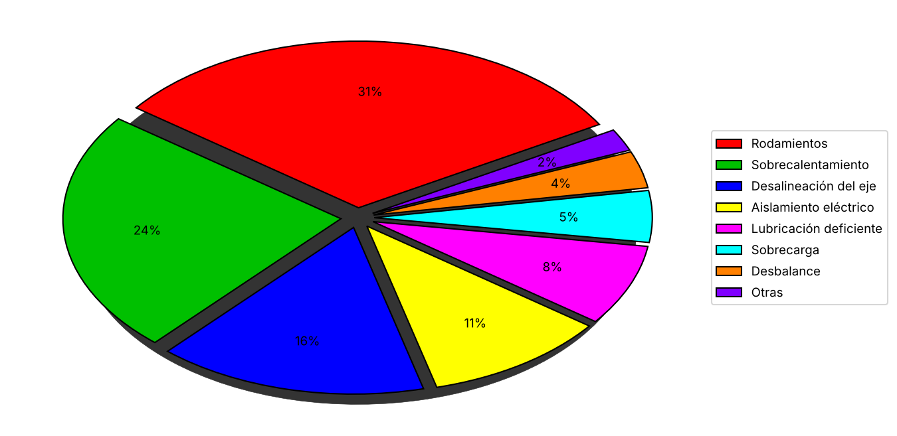
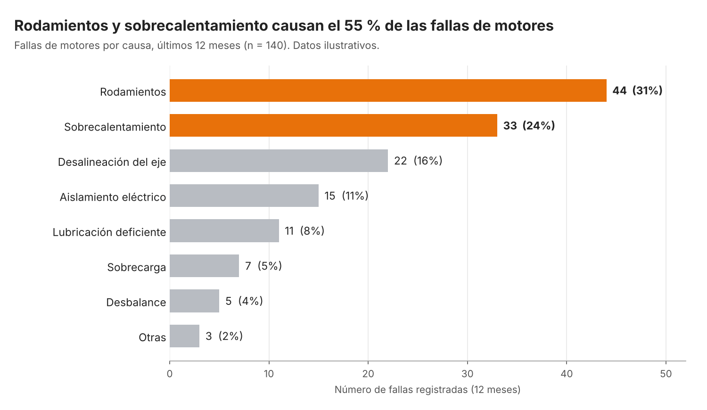

# Actividad Opcional – Semana 12: Rediseña un gráfico

**Estudiante:** Isabella Ramos Betancourt  
**Universidad:** Corporación Universitaria del Huila – CORHUILA (Facultad de Ingeniería, Ingeniería Industrial)  
**Asignatura:** Ciencia de Datos – Código 69109 · Pénsum 40D · Grupo 1  
**Docente:** Jesús Ariel Gonzáles Bonilla  
**Periodo:** 2026-B · Unidad 3 – Corte 3  
**Fecha:** 8 de noviembre de 2026  

---

## 1. Introducción

Un gráfico existe para acelerar una decisión: traduce números en formas que el ojo interpreta en segundos. Cuando el gráfico está mal construido ocurre lo contrario: el lector pierde tiempo, interpreta mal o, peor aún, llega a una conclusión equivocada. Por eso, elegir el tipo de gráfico, mantener una escala honesta, usar el color con propósito y redactar un título que enuncie la conclusión no son asuntos estéticos, sino de rigor analítico (Cairo, 2019; Knaflic, 2015).

Esta actividad aplica esos principios al caso central de la asignatura, el mantenimiento predictivo de equipos industriales. Se parte de un gráfico deficiente (una torta con efecto 3D, ocho porciones, colores sin criterio y sin título) que representa las fallas de motores de una planta según su causa, y se rediseña hasta que comunique con claridad dónde debe concentrarse el esfuerzo de mantenimiento. El documento presenta el diagnóstico del problema (sección 2), el rediseño con los principios aplicados (sección 3), la justificación de las decisiones (sección 4) y una conclusión (sección 5).

> **Nota sobre los datos:** las cifras son **ilustrativas (simuladas)** y se crearon únicamente para esta actividad; no corresponden a registros de una empresa real. El script `generar_graficos.py`, incluido en esta carpeta, reproduce ambas imágenes.

---

## 2. Diagnóstico del problema

### 2.1 Gráfico original (antes)

*Figura 1. Gráfico original: fallas de motores por causa (12 meses, n = 140).*

### 2.2 Problemas identificados

El gráfico original incumple varios de los principios de visualización efectiva revisados en la sesión de la semana 12:

| # | Problema detectado | Por qué afecta la lectura | Principio incumplido |
|---|--------------------|---------------------------|----------------------|
| 1 | **Tipo de gráfico inadecuado:** torta con ocho categorías | El ojo compara mal los ángulos y las áreas; con tantas porciones, las pequeñas (2 %, 4 %, 5 %) son casi indistinguibles. La torta solo se recomienda con pocas categorías. | Elegir el gráfico según la pregunta (comparar categorías → barras) |
| 2 | **Efecto 3D innecesario** | La profundidad y la perspectiva deforman el tamaño aparente de las porciones del frente y suman adorno sin información. | Menos es más (*data-ink*) |
| 3 | **Color sin propósito:** ocho colores saturados de arcoíris | Todas las porciones compiten por la atención; nada indica cuál es la causa importante. | Color con propósito |
| 4 | **Sin título ni conclusión** | El lector debe adivinar qué se mide, en qué periodo y qué debería concluir. | Claridad: título que dice la conclusión |
| 5 | **Sin unidades ni cantidades absolutas** | Solo se muestran porcentajes; no se sabe cuántas fallas son ni sobre qué total. | Etiquetas y unidades siempre |
| 6 | **Leyenda separada del dato** | Obliga a ir y venir entre el color de la leyenda y la porción. | Claridad |

**Diagnóstico general:** el gráfico es técnicamente "correcto" en que las proporciones suman 100 %, pero no responde ninguna pregunta de negocio. La pregunta real del área de mantenimiento es *¿en qué causas conviene invertir primero?*, y esta torta no permite contestarla de un vistazo.

---

## 3. Rediseño (después)

### 3.1 Gráfico rediseñado

*Figura 2. Gráfico rediseñado: fallas de motores por causa (12 meses, n = 140). Datos ilustrativos.*

### 3.2 Principios aplicados

| Principio | Decisión de rediseño |
|-----------|----------------------|
| **Gráfico correcto** | Se reemplazó la torta por **barras horizontales**, el gráfico adecuado para comparar categorías. Las etiquetas largas se leen sin rotar el texto. |
| **Escala honesta** | El eje parte de **0** y las barras son proporcionales al número de fallas; no hay truncamientos ni perspectiva. |
| **Título con conclusión** | El título dice el hallazgo: *«Rodamientos y sobrecalentamiento causan el 55 % de las fallas de motores»*; el subtítulo aclara qué se mide, el periodo y el tamaño de la muestra (n = 140). |
| **Color con propósito** | Un solo color de énfasis (naranja) resalta las dos causas principales; el resto va en gris neutro. |
| **Menos es más** (Tufte, 1983) | Se eliminaron el 3D, la leyenda, las sombras, los bordes del gráfico y las líneas de cuadrícula innecesarias; solo queda una cuadrícula vertical tenue. |
| **Etiquetas y unidades** | Cada barra muestra su valor absoluto y su porcentaje; el eje indica la unidad («Número de fallas registradas (12 meses)»). Las categorías están **ordenadas de mayor a menor**. |

---

## 4. Justificación de las mejoras

En el gráfico original, el lector tenía que descifrar ocho colores y comparar ángulos para entender algo que el rediseño muestra de inmediato. Se cambió la torta por barras horizontales ordenadas porque comparar la longitud de barras alineadas desde un mismo cero es una tarea visual mucho más precisa que comparar ángulos y áreas, y porque la pregunta de fondo es una comparación entre categorías. Se mantuvo una escala honesta (eje desde 0, sin 3D) para que la diferencia visual entre las causas refleje exactamente la diferencia en los datos.

El título pasó de no existir a enunciar la conclusión (el 55 % de las fallas proviene de rodamientos y sobrecalentamiento, es decir, 77 de 140 eventos), de modo que el mensaje se entiende antes de analizar las barras. Finalmente, el color se usa con intención: el naranja dirige la atención hacia las dos causas donde una intervención (por ejemplo, un plan de lubricación y monitoreo de temperatura y vibración con sensores IoT) tendría mayor impacto, mientras que el gris relega a segundo plano el resto de las causas. Con las tres primeras causas se acumula el 71 % de las fallas (99 de 140), lo que sustenta priorizar el mantenimiento predictivo en esos modos de falla.

---

## 5. Conclusión

El rediseño muestra que la mejora de un gráfico no consiste en hacerlo más vistoso, sino en hacerlo más honesto y más útil para decidir. Con los mismos datos, pasar de una torta 3D saturada a unas barras ordenadas, con escala desde cero, título con conclusión y color de énfasis, transforma una imagen decorativa en una herramienta que responde la pregunta del área de mantenimiento: las fallas de rodamientos y por sobrecalentamiento concentran más de la mitad de los eventos y deben atenderse primero.

En el contexto del mantenimiento predictivo, donde los datos de sensores y el historial de fallas alimentan decisiones de inversión y de intervención, comunicar bien un hallazgo es parte del trabajo del analista: un gráfico engañoso o confuso puede desviar recursos, y uno claro puede justificarlos. Aplicar estos principios de forma sistemática es, en últimas, una responsabilidad profesional con los datos y con quien toma la decisión.

---

## Referencias

Cairo, A. (2019). *How charts lie: Getting smarter about visual information*. W. W. Norton & Company.

Knaflic, C. N. (2015). *Storytelling with data: A data visualization guide for business professionals*. Wiley.

Tufte, E. R. (1983). *The visual display of quantitative information*. Graphics Press.
