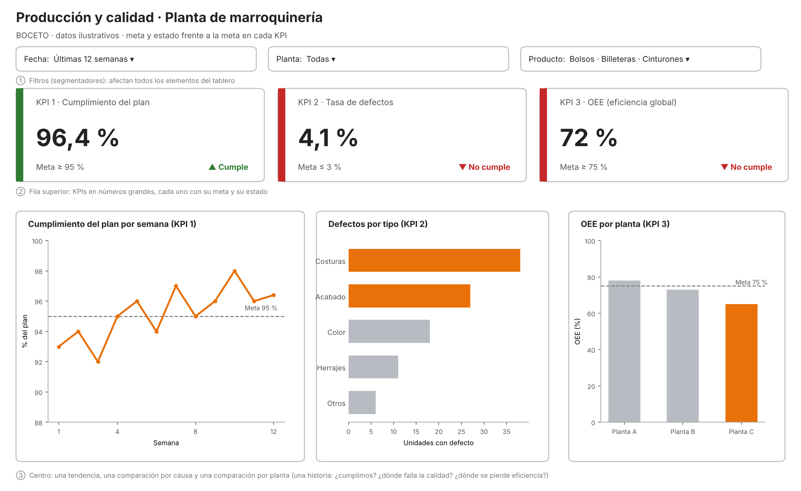

# Actividad Opcional – Semana 13: Diseña un dashboard

**Estudiante:** Isabella Ramos Betancourt  
**Universidad:** Corporación Universitaria del Huila – CORHUILA (Facultad de Ingeniería, Ingeniería Industrial)  
**Asignatura:** Ciencia de Datos – Código 69109 · Pénsum 40D · Grupo 1  
**Docente:** Jesús Ariel Gonzáles Bonilla  
**Periodo:** 2026-B · Unidad 3 – Corte 3  
**Fecha:** 8 de noviembre de 2026  

---

## 1. Introducción

Un dashboard (tablero) integra en una sola pantalla indicadores, gráficos y filtros para que quien toma decisiones pueda responder, de un vistazo, dos preguntas: ¿cómo vamos? y ¿dónde está el problema?. Su valor no depende de cuántos gráficos contenga, sino de qué tan bien selecciona lo importante y lo ordena: un tablero saturado, con números sin meta o con colores sin criterio obliga al lector a trabajar más de lo necesario y termina sin usarse (Few, 2013; Knaflic, 2015).

Esta actividad diseña, en forma de boceto, un dashboard para el proceso de **producción y calidad de una planta de marroquinería**, el sector de la empresa Vélez S.A.S., caso colombiano trabajado en el primer corte de la asignatura (Vélez S.A.S., s. f.). El documento define el proceso y los tres KPIs con su objetivo (sección 2), presenta el boceto con el gráfico asociado a cada KPI y los filtros (sección 3), justifica el orden y la jerarquía visual (sección 4) y cierra con una conclusión (sección 5).

> **Nota sobre los datos:** se trata de un **boceto de diseño**. Las metas son propuestas para el ejercicio y las cifras y formas dibujadas en los gráficos son **ilustrativas (simuladas)**; no corresponden a registros de Vélez S.A.S. ni de otra empresa real. El script `generar_boceto.py`, incluido en esta carpeta, reproduce la imagen.

---

## 2. Proceso elegido y KPIs con su objetivo

### 2.1 Proceso

Se eligió el **proceso de producción con control de calidad** de una planta de marroquinería (bolsos, billeteras y cinturones). Es un proceso adecuado para un tablero porque combina tres preguntas que la gerencia de planta se hace cada semana: si se está cumpliendo lo programado, si lo producido sale bien a la primera y si las máquinas y las personas se están aprovechando.

### 2.2 KPIs

Siguiendo la recomendación de la sesión, se destacan **pocos KPIs relevantes** y cada uno se presenta con un objetivo, porque un número sin meta no dice si el resultado es bueno o malo.

| # | KPI | Definición y fórmula | Objetivo (meta) | Qué proceso mide | Frecuencia |
|---|-----|----------------------|-----------------|------------------|------------|
| 1 | **Cumplimiento del plan de producción** | (Unidades producidas ÷ unidades programadas) × 100 | **≥ 95 %** | Producción | Semanal |
| 2 | **Tasa de defectos** | (Unidades con defecto ÷ unidades inspeccionadas) × 100 | **≤ 3 %** | Calidad | Semanal |
| 3 | **OEE (eficiencia global del equipo)** | Disponibilidad × Rendimiento × Calidad | **≥ 75 %** | Aprovechamiento de los equipos | Semanal |

**Por qué estos tres.** Juntos cuentan una sola historia: el KPI 1 dice *cuánto* se produjo frente a lo planeado, el KPI 2 dice *qué tan bien* se produjo y el KPI 3 dice *qué tan eficientemente* se usaron los recursos. Se evitó añadir más indicadores para no saturar el tablero. Los tres son medibles con datos que una planta ya registra (órdenes de producción, inspección final y tiempos de máquina), y cada uno tiene un responsable claro: programación, control de calidad y mantenimiento/producción, respectivamente.

---

## 3. Boceto del dashboard

*Figura 1. Boceto del dashboard «Producción y calidad · Planta de marroquinería». Datos ilustrativos.*

### 3.1 Gráfico asignado a cada KPI

| KPI | Gráfico | Por qué este gráfico |
|-----|---------|----------------------|
| **1. Cumplimiento del plan** | **Línea** semanal con una línea punteada en la meta (95 %) | La pregunta es cómo evoluciona en el tiempo; la línea muestra tendencia y permite ver de inmediato en qué semanas se quedó por debajo de la meta. |
| **2. Tasa de defectos** | **Barras horizontales ordenadas** por tipo de defecto (costuras, acabado, color, herrajes, otros) | La pregunta es qué tipo de defecto pesa más; comparar longitudes de barras alineadas desde cero es más preciso que comparar áreas, y el orden de mayor a menor deja ver dónde actuar primero. |
| **3. OEE** | **Barras verticales** por planta con una línea en la meta (75 %) | La pregunta es qué planta está por debajo; pocas categorías comparadas contra una meta común se leen mejor en barras. |

### 3.2 Filtros (segmentadores)

| Filtro | Tipo | Valores del boceto | Efecto |
|--------|------|--------------------|--------|
| **Fecha** | Rango / lista desplegable | Últimas 12 semanas (también mes y trimestre) | Recalcula los KPIs y todos los gráficos para el periodo elegido. |
| **Planta** | Lista desplegable | Todas · Planta A · Planta B · Planta C | Permite aislar una planta; con «Todas» se compara entre plantas. |
| **Producto** | Lista desplegable | Bolsos · Billeteras · Cinturones | Permite ver si el problema es de una línea de producto. |

Los tres filtros son **globales**: se aplican a los KPIs y a los tres gráficos a la vez, de modo que el tablero cuenta siempre la misma historia con el mismo recorte de datos. En una herramienta como Power BI se implementarían como segmentadores sobre un modelo con las tablas de producción, inspección y tiempos de máquina, y los KPIs como medidas DAX.

### 3.3 Uso del color

El tablero usa el **color con propósito**. Cada tarjeta de KPI lleva una franja verde (cumple) o roja (no cumple), y el estado se escribe también con texto y símbolo («▲ Cumple», «▼ No cumple») para que no dependa solo del color. En los gráficos, el naranja resalta únicamente lo que merece atención (las dos causas de defecto principales y la planta con menor OEE); lo demás va en gris neutro.

---

## 4. Justificación del orden y la jerarquía visual

El tablero se organiza en tres niveles, de lo más general a lo más detallado, siguiendo la regla de que quien lo abre debe obtener la respuesta principal en pocos segundos:

1. **Arriba: encabezado y filtros.** Los filtros van en la parte superior porque definen sobre qué datos se leerá todo lo demás; quien los ve primero entiende el alcance (periodo, planta y producto) antes de interpretar una cifra.
2. **Segundo nivel: los tres KPIs en números grandes.** Es la zona de mayor jerarquía visual (tamaño de cifra más grande, tarjetas con meta y estado) porque responde la pregunta «¿cómo vamos?». En la lectura natural, de arriba a abajo y de izquierda a derecha, el orden de los KPIs sigue la lógica del proceso: primero lo producido, luego su calidad y por último la eficiencia. Con un vistazo se ve que el cumplimiento del plan es bueno, pero que defectos y OEE no alcanzan su meta.
3. **Centro: los tres gráficos de apoyo**, alineados debajo del KPI al que explican y en el mismo orden. Responden «¿dónde está el problema?»: la tendencia semanal muestra cuándo se perdió el cumplimiento, el gráfico de barras de defectos indica qué tipo de defecto atacar primero (costuras y acabado suman 65 de cada 100 unidades con defecto en el boceto) y el OEE por planta señala dónde se pierde eficiencia.

**Decisiones de diseño complementarias.** Se limitó el tablero a tres KPIs y tres gráficos para contar una sola historia y evitar la saturación; cada KPI tiene su meta visible para dar contexto; los gráficos usan escalas honestas (barras desde cero) y títulos que dicen qué se mide; y la interactividad se concentra en los filtros globales, sin elementos decorativos. De esta manera se evitan los cuatro errores comunes señalados en la sesión: saturar, mostrar KPIs sin objetivo, omitir filtros y usar colores sin criterio.

---

## 5. Conclusión

Diseñar un dashboard es, ante todo, decidir qué mostrar y en qué orden. A partir de un proceso concreto, la producción y el control de calidad de una planta de marroquinería, se seleccionaron tres KPIs con su objetivo (cumplimiento del plan ≥ 95 %, tasa de defectos ≤ 3 % y OEE ≥ 75 %), cada uno asociado al gráfico que mejor responde su pregunta, y se organizaron bajo filtros globales de fecha, planta y producto. La jerarquía visual (filtros, KPIs con estado y gráficos de diagnóstico) permite pasar de «¿cómo vamos?» a «¿dónde está el problema?» sin esfuerzo adicional.

Para el trabajo de un ingeniero industrial, el tablero es el puente entre los datos y la decisión: de nada sirve registrar la producción, las inspecciones y los tiempos de máquina si quien decide no puede leerlos con rapidez y confianza. Un diseño sobrio, con pocas métricas, metas explícitas y color con propósito, convierte esos datos en una herramienta de seguimiento y mejora continua, y es el paso previo natural a construir el tablero en Power BI con datos reales.

---

## Referencias

Few, S. (2013). *Information dashboard design: Displaying data for at-a-glance monitoring* (2.ª ed.). Analytics Press.

Knaflic, C. N. (2015). *Storytelling with data: A data visualization guide for business professionals*. Wiley.

Vélez S.A.S. (s. f.). *Vélez*. https://www.velez.com.co
