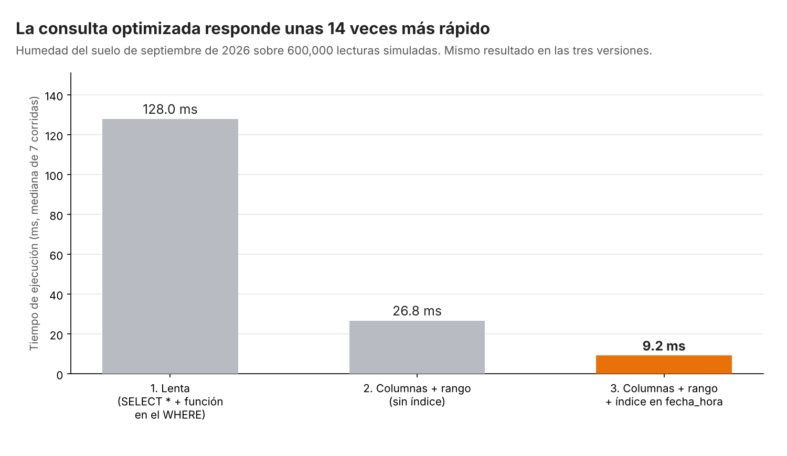

# Actividad Opcional – Semana 14: Optimiza una consulta (opción A: SQL)

**Estudiante:** Isabella Ramos Betancourt  
**Universidad:** Corporación Universitaria del Huila – CORHUILA (Facultad de Ingeniería, Ingeniería Industrial)  
**Asignatura:** Ciencia de Datos – Código 69109 · Pénsum 40D · Grupo 1  
**Docente:** Jesús Ariel Gonzáles Bonilla  
**Periodo:** 2026-B · Unidad 3 – Corte 3  
**Fecha:** 8 de noviembre de 2026

```yaml
# CONFIG
FULL_NAME: Isabella Ramos Betancourt
GITHUB_USER: Isarb-21
```

---

## 1. Introducción

Con pocos datos casi cualquier consulta responde rápido; el problema aparece cuando la tabla crece. Optimizar una consulta significa obtener **el mismo resultado usando menos recursos**, y se logra con tres prácticas básicas: traer solo las columnas necesarias, filtrar con condiciones que el motor pueda resolver con un índice y evitar funciones aplicadas sobre la columna del `WHERE`, porque impiden usar ese índice (Silberschatz et al., 2020).

Esta actividad aplica esas prácticas a la tabla `lectura_sensor` del proyecto de **Gestión del Riego Agroindustrial** (modelo ERD de la Semana 6 y limpieza de la Semana 9). Esa tabla es la que más crece en el caso, porque cada sonda de humedad y temperatura genera lecturas de forma continua. Se elige la **opción A (SQL)**: se parte de una consulta lenta, se reescribe, se mide el antes y el después y se explica por qué mejora. El documento presenta el escenario (sección 2), la consulta antes y después (sección 3), la medición (sección 4), la explicación de la mejora (sección 5) y una conclusión (sección 6).

> **Nota sobre los datos:** la tabla de 600 000 lecturas es **simulada** y se creó únicamente para poder medir tiempos; no corresponde a registros de una finca real. Los tiempos dependen del equipo y varían entre corridas, por lo que lo importante es la **proporción** entre versiones y el cambio en el plan de ejecución, no el valor absoluto en milisegundos. El script `generar_benchmark.py`, incluido en esta carpeta, reproduce todo (tabla, mediciones, `resultados.json` y la imagen).

---

## 2. Escenario

**Pregunta de negocio:** ¿cuál fue la humedad promedio del suelo en cada lote durante septiembre de 2026? Es el insumo para comparar el comportamiento del suelo con los riegos aplicados ese mes (Semana 9, Consulta 1).

**Tabla:** `lectura_sensor(id_lectura PK, id_lote, fecha_hora, humedad_suelo_pct, temperatura_c)`, con una lectura cada 5 minutos por lote, de diciembre de 2024 a octubre de 2026 (600 000 filas, tres lotes). La consulta necesita únicamente `id_lote` y `humedad_suelo_pct`, y solo las lecturas de septiembre de 2026 (25 920 filas).

---

## 3. Consulta antes y después

### 3.1 Antes (lenta)

```sql
SELECT *
FROM lectura_sensor
WHERE strftime('%Y-%m', fecha_hora) = '2026-09';
```

Es la versión que se escribe de forma natural, con dos defectos: trae las cinco columnas cuando solo se necesitan dos, y aplica la función `strftime` sobre `fecha_hora` dentro del `WHERE`. Es el mismo patrón de la sesión (`WHERE YEAR(fecha) = 2026`), adaptado a SQLite, que no tiene `YEAR()`.

### 3.2 Después (optimizada)

```sql
-- Se crea una sola vez
CREATE INDEX idx_lectura_fecha ON lectura_sensor(fecha_hora);

SELECT id_lote, humedad_suelo_pct
FROM lectura_sensor
WHERE fecha_hora >= '2026-09-01' AND fecha_hora < '2026-10-01';
```

### 3.3 Cambios realizados

| # | Cambio | Práctica aplicada |
|---|--------|-------------------|
| 1 | `SELECT *` → `SELECT id_lote, humedad_suelo_pct` | Traer solo las columnas necesarias |
| 2 | `strftime(...) = '2026-09'` → rango `>= '2026-09-01' AND < '2026-10-01'` | No aplicar funciones sobre la columna filtrada |
| 3 | `CREATE INDEX idx_lectura_fecha ON lectura_sensor(fecha_hora)` | Indexar la columna de búsqueda |

El rango usa el límite superior **exclusivo** (`< '2026-10-01'`) para incluir todo septiembre sin depender de cuántos segundos tenga la última lectura del mes.

---

## 4. Medición del antes y el después

Cada versión se ejecutó 7 veces y se reporta la **mediana**. Se separó el efecto de los cambios 1 y 2 (versión 2, sin índice) del efecto del índice (versión 3), para saber cuánto aporta cada uno.

| Versión | Tiempo (mediana) | Plan de ejecución (`EXPLAIN QUERY PLAN`) | Filas devueltas |
|---------|------------------|------------------------------------------|-----------------|
| 1. Lenta: `SELECT *` + función en el `WHERE` | **128,0 ms** | `SCAN lectura_sensor` (lee toda la tabla) | 25 920 |
| 2. Columnas necesarias + rango, **sin** índice | **26,8 ms** | `SCAN lectura_sensor` (lee toda la tabla) | 25 920 |
| 3. Columnas necesarias + rango + **índice** | **9,2 ms** | `SEARCH ... USING INDEX idx_lectura_fecha` | 25 920 |



*Figura 1. Tiempo de ejecución de las tres versiones. Datos simulados.*

**Verificación del resultado.** Optimizar no debe cambiar la respuesta. El script calcula la humedad promedio por lote con la consulta lenta y con la rápida y comprueba que coinciden (con `assert`):

| Lote | Humedad promedio, septiembre 2026 (%) |
|------|---------------------------------------|
| LOT-001 | 41,926 |
| LOT-002 | 41,970 |
| LOT-003 | 42,056 |

**Resumen de la mejora:** la versión final es unas **14 veces más rápida** que la original (128,0 ms → 9,2 ms). Reescribir columnas y filtro aporta unas 4,8 veces (128,0 → 26,8 ms) y el índice aporta otras 2,9 veces (26,8 → 9,2 ms).

---

## 5. Por qué mejora

1. **Menos columnas, menos datos que mover.** `SELECT *` obliga al motor a leer y devolver las cinco columnas de cada fila; la consulta solo necesita dos. Con millones de filas y un servidor remoto, esto también reduce lo que viaja por la red.
2. **Filtro por rango en lugar de función.** Con `strftime(...)` en el `WHERE`, el motor debe calcular la función **fila por fila** y comparar el resultado, así que no puede aprovechar ningún índice sobre `fecha_hora`: el plan sigue siendo `SCAN`. Con un rango sobre la columna sin transformar, la condición se puede resolver comparando directamente contra el índice. El plan de la versión 2 sigue siendo `SCAN` porque todavía no existe el índice; aun así es más rápida porque ya no evalúa una función por fila ni lee las cinco columnas.
3. **El índice evita leer toda la tabla.** Un índice funciona como el índice de un libro: permite ir directo al bloque de septiembre sin recorrer los 600 000 registros. El cambio se ve en el plan: de `SCAN lectura_sensor` a `SEARCH ... USING INDEX idx_lectura_fecha (fecha_hora>? AND fecha_hora<?)` (SQLite, s. f.).
4. **Costo del índice.** Un índice ocupa espacio y hace un poco más lentas las inserciones. En este caso es una buena decisión porque la tabla se **consulta por fecha con mucha frecuencia** y se llena en lote desde el pipeline ETL (Semana 8); en una tabla que solo recibe escrituras y casi nunca se consulta, no valdría la pena.

**Limitación de la medición.** Es un experimento con datos simulados en SQLite en memoria; en una base de datos real (PostgreSQL, por ejemplo) los tiempos cambian, pero el patrón (función en el `WHERE` impide usar el índice; filtro por rango sí) es el que enseña la sesión. Además, con una tabla pequeña la diferencia sería imperceptible: la ventaja crece a medida que aumenta el número de filas.

---

## 6. Conclusión

La misma pregunta de negocio se respondió en 9,2 ms en lugar de 128,0 ms y con el mismo resultado, solo reescribiendo la consulta con buenas prácticas (columnas necesarias, filtro por rango sin funciones sobre la columna) y creando un índice sobre `fecha_hora`. La medición por pasos mostró que ambos grupos de cambios aportan, y el plan de ejecución confirmó el motivo: el motor pasó de recorrer toda la tabla a buscar directamente en el índice.

Para el proyecto de riego, esto importa porque las lecturas de sensores crecen sin parar y los tableros de Power BI (Semana 13) se alimentan de consultas como esta; una consulta eficiente hace que el análisis y las alertas de humedad sigan siendo oportunos cuando la tabla pase de cientos de miles a millones de filas. Y la regla de fondo es la última de los errores comunes de la sesión: **no optimizar sin medir**, comparando siempre el antes y el después.

---

## Referencias

Silberschatz, A., Korth, H. F., & Sudarshan, S. (2020). *Database System Concepts* (7th ed.). McGraw-Hill Education.

SQLite. (s. f.). *EXPLAIN QUERY PLAN*. https://www.sqlite.org/eqp.html
