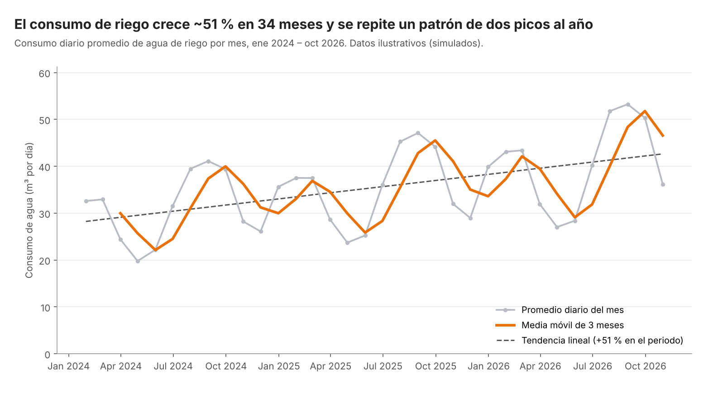
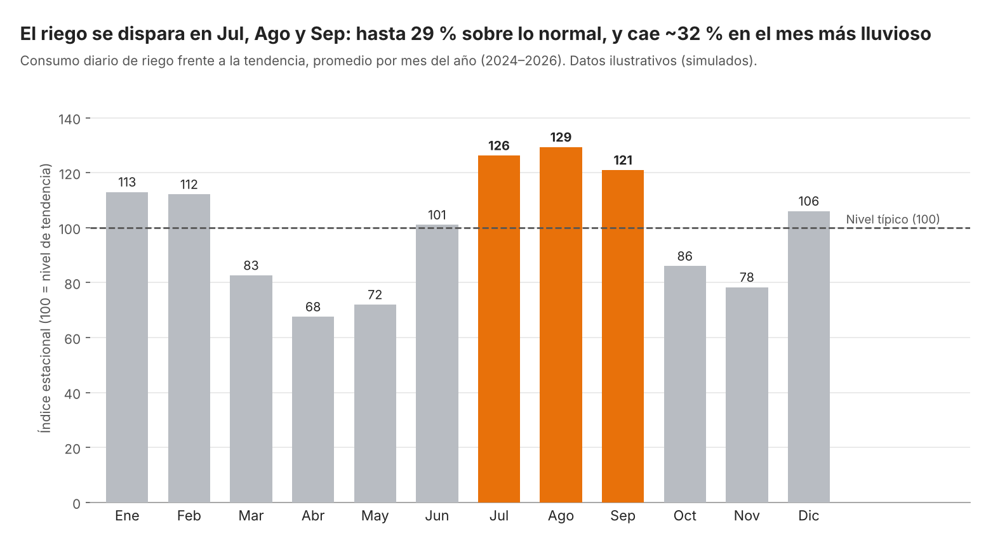

# Actividad Calificable · Corte 3
## Análisis temporal y visualización
### 🌱 Caso: Gestión del Riego Agroindustrial basada en Datos

```yaml
# CONFIG
FULL_NAME: Isabella Ramos Betancourt
GITHUB_USER: Isarb-21
```

**Isabella Ramos Betancourt**  
Facultad de Ingeniería, Corporación Universitaria del Huila (CORHUILA)  
Ciencia de Datos (Cód. 69109) [Pénsum 40D, Grupo 1]  
Jesús Ariel Gonzáles Bonilla  
Noviembre de 2026  

---

## 1. Introducción

Los datos de un proceso productivo casi siempre tienen una dimensión temporal: el consumo de agua se registra cada día, la humedad cada hora y la cosecha cada ciclo. Una serie de tiempo permite ver cómo evoluciona una variable y anticipar su comportamiento, pero para leerla es necesario separar sus componentes: la **tendencia** (dirección de largo plazo), la **estacionalidad** (patrones que se repiten) y el **ruido** (variación aleatoria) (Hyndman & Athanasopoulos, 2021).

En los cortes anteriores se trabajó la **Gestión del Riego Agroindustrial**, donde una programación inadecuada del agua genera desperdicio por exceso o pérdida de rendimiento por estrés hídrico. De acuerdo con la FAO (2026), el monitoreo continuo de las variables hídricas es indispensable para mejorar la productividad del agua. Esta actividad retoma ese caso y analiza el **consumo diario de agua de riego (m³/día)**: se agrega por mes con `resample`, se suaviza con una media móvil, se describen tendencia y estacionalidad (sección 2), se construyen dos visualizaciones, una de evolución y otra de comparación (sección 3), y se optimiza una consulta SQL sobre la tabla `registro_riego` del modelo de la Semana 6 (sección 4). La sección 5 presenta los *Findings* en inglés y la sección 6 la conclusión.

> **Nota sobre los datos:** las cifras son **ilustrativas (simuladas)**, creadas únicamente para esta actividad con un régimen de lluvias bimodal (meses secos con mayor demanda de riego) y un crecimiento gradual por ampliación del área regada; no corresponden a registros de una finca real. El script `analisis_serie_temporal.py` genera el CSV y reproduce ambas imágenes, y `optimizar_consulta.py` reproduce la medición de la sección 4.

### Archivos de la entrega

| Archivo | Contenido |
|---|---|
| `analisis_serie_temporal.py` | Serie diaria simulada, `resample`, media móvil, tendencia, estacionalidad y gráficos |
| `consumo_riego_diario.csv` / `consumo_riego_mensual.csv` | Serie diaria (1 035 filas) y su agregación mensual (34 meses) |
| `grafico_evolucion.png` / `grafico_comparacion.png` | Visualizaciones 1 y 2 |
| `optimizar_consulta.py` | Consulta SQL antes/después con plan de ejecución y tiempos |

---

## 2. Serie temporal: resample, media móvil, tendencia y estacionalidad

### 2.1 Carga y agregación (pandas)

La serie diaria (2024-01-01 a 2026-10-31) se carga con la fecha como índice y se agrega por mes (McKinney, 2022). Como los meses tienen distinta cantidad de días, además del total mensual se calcula el **promedio diario del mes** para que la comparación sea justa.

```python
import pandas as pd

df = pd.read_csv("consumo_riego_diario.csv", parse_dates=["fecha"]).set_index("fecha")

mensual = df["volumen_agua_m3"].resample("ME").sum().to_frame("total_m3")   # agregar por mes
mensual["dias"] = mensual.index.days_in_month
mensual["m3_por_dia"] = mensual["total_m3"] / mensual["dias"]
mensual["media_movil_3m"] = mensual["m3_por_dia"].rolling(3).mean()          # media móvil
```

Resultado: **1 035 filas diarias → 34 meses**. La media móvil de 3 meses suaviza el ruido; sus dos primeros valores son `NaN` porque `rolling(3)` necesita tres meses completos.

```
            total_m3  dias  m3_por_dia  media_movil_3m
2024-01-31   1010.53    31       32.60             NaN
2024-02-29    954.86    29       32.93             NaN
2024-03-31    756.62    31       24.41           29.98
2024-04-30    593.39    30       19.78           25.70
```

### 2.2 Tendencia y estacionalidad

- **Tendencia:** una regresión lineal sobre el promedio diario mensual da una pendiente de **+0,44 m³/día por mes**, equivalente a un crecimiento de **≈ 51 %** a lo largo de los 34 meses. Es una tendencia creciente, coherente con una finca que amplía su área bajo riego.
- **Estacionalidad:** se calculó un **índice estacional** (valor del mes ÷ valor de la tendencia × 100, promediado por mes del año). Hay dos máximos al año: **julio–septiembre** (126, 129 y 121) y un máximo menor en **enero–febrero** (113 y 112). Los mínimos están en **abril, mayo y noviembre** (68, 72 y 78), meses de lluvia en los que el riego se reduce.

**Interpretación (tendencia y estacionalidad).** El consumo de agua sube de forma sostenida, pero no de manera uniforme: sobre esa tendencia se repite cada año un patrón de dos picos, que coincide con los periodos secos, y dos valles, que coinciden con los periodos de lluvia. La estacionalidad es tan marcada (de 68 a 129 sobre una base de 100) que comparar julio con abril sin ajustar llevaría a conclusiones erróneas; este es uno de los errores comunes señalados en la sesión. Con apenas tres ciclos observados, el patrón es una primera evidencia y no una conclusión definitiva.

---

## 3. Visualizaciones

### 3.1 Visualización 1 · Evolución (gráfico de líneas)



*Figura 1. Consumo diario promedio de agua de riego por mes, con media móvil de 3 meses y tendencia lineal (ene 2024 – oct 2026). Datos ilustrativos.*

La pregunta es **cómo evoluciona** el consumo en el tiempo, por lo que corresponde un gráfico de líneas. La línea gris muestra el dato mensual, la media móvil naranja revela el ciclo suavizado y la línea punteada marca la tendencia.

### 3.2 Visualización 2 · Comparación (gráfico de barras)



*Figura 2. Índice estacional del consumo de riego por mes del año (100 = nivel de tendencia), 2024–2026. Datos ilustrativos.*

La pregunta es **qué meses consumen más que lo normal**, una comparación entre categorías, por lo que corresponden barras. Se usa el índice estacional (y no el consumo bruto) para que el crecimiento de la tendencia no distorsione la comparación entre meses.

### 3.3 Principios de visualización aplicados

Se siguieron los principios revisados en la sesión de la Semana 12 y las recomendaciones de Knaflic (2015) sobre claridad, color con propósito y títulos que comunican el hallazgo:

| Principio | Cómo se aplicó |
|---|---|
| **Gráfico correcto** | Líneas para evolución temporal; barras para comparar categorías (meses) |
| **Título con conclusión** | Fig. 1: «El consumo de riego crece ~51 % en 34 meses y se repite un patrón de dos picos al año». Fig. 2: «El riego se dispara en Jul, Ago y Sep: hasta 29 % sobre lo normal, y cae ~32 % en el mes más lluvioso» |
| **Escala honesta** | Ambos ejes Y parten de **0**; en las barras la altura es proporcional al valor y la referencia 100 está marcada con una línea |
| **Color con propósito** | Naranja solo para lo que importa (media móvil; los tres meses de mayor consumo); gris neutro para el resto |
| **Menos es más** | Sin 3D, sin bordes ni leyendas innecesarias, con una cuadrícula horizontal tenue |
| **Etiquetas y unidades** | Ejes con unidad (m³ por día; índice base 100), valores sobre cada barra y subtítulo que indica periodo y que los datos son simulados |

---

## 4. Optimización de una consulta SQL

### 4.1 Consulta antes (lenta)

**Pregunta de negocio:** ¿cuánta agua se aplicó en el lote `LOT-001` durante 2026? Se mide sobre una tabla `registro_riego` simulada de **400 000 filas** (SQLite en memoria).

```sql
-- ANTES: SELECT * + función sobre la columna filtrada
SELECT * FROM registro_riego
WHERE YEAR(fecha) = 2026 AND id_lote = 'LOT-001';
-- (en SQLite: strftime('%Y', fecha) = '2026')
```

Problemas: `SELECT *` trae las 7 columnas cuando solo se necesitan 2; la función `YEAR()` aplicada a `fecha` obliga a calcularla fila por fila e impide usar un índice; y no existe ningún índice. El plan de ejecución confirma una lectura completa de la tabla: `SCAN registro_riego`.

### 4.2 Consulta después (optimizada)

```sql
-- Índice compuesto y cubriente: igualdad (lote) + rango (fecha) + columna que se lee
CREATE INDEX idx_riego_lote_fecha ON registro_riego (id_lote, fecha, volumen_agua_m3);

-- DESPUÉS: columnas necesarias + filtro por rango sobre la columna "limpia"
SELECT fecha, volumen_agua_m3
FROM registro_riego
WHERE id_lote = 'LOT-001'
  AND fecha >= '2026-01-01' AND fecha < '2027-01-01';
```

### 4.3 Resultado de la medición

| | Antes | Después |
|---|---|---|
| Plan de ejecución | `SCAN registro_riego` | `SEARCH … USING COVERING INDEX idx_riego_lote_fecha` |
| Columnas devueltas | 7 | 2 |
| Filas devueltas | 39 142 | 39 142 |
| Suma de volumen (m³) | 137 345,89 | 137 345,89 |
| Tiempo (mediana de 7 ejecuciones) | 92,3 ms | 12,8 ms |

**Mejora: ≈ 7,2 veces más rápida (86 % menos de tiempo)** con el mismo resultado (mismas filas y misma suma). Los tiempos exactos varían de un equipo a otro, pero la diferencia entre *scan* y *search* por índice se mantiene.

### 4.4 Por qué mejora

1. **Filtro por rango en lugar de función sobre la columna:** `fecha >= … AND fecha < …` es «sargable», es decir, el motor puede usar el índice.
2. **Índice compuesto (`id_lote`, `fecha`):** el motor salta directo a las filas del lote y del rango, como en el índice de un libro, sin leer toda la tabla.
3. **Solo las columnas necesarias:** al pedir 2 columnas, el índice las contiene todas (*covering index*) y ni siquiera hace falta leer la tabla.
4. **Medir antes y después:** se comparó el plan y el tiempo, no solo se asumió la mejora; esto evita «optimizar a ciegas».

> **Compromiso a tener en cuenta:** un índice acelera las lecturas pero ocupa espacio y hace un poco más lentas las escrituras, por lo que conviene crearlo en las columnas que realmente se consultan.

---

## 5. Findings

The simulated daily irrigation water consumption (January 2024 to October 2026) was aggregated by month with `resample` and smoothed with a 3-month moving average. The series shows a clear upward trend: a linear fit gives about +0.44 m³/day per month, roughly a 51 % increase over the 34 months, which is consistent with a farm that keeps expanding its irrigated area. On top of that trend there is a strong seasonality with two peaks per year, the highest between July and September (seasonal index of 121–129) and a smaller one in January and February (112–113). The lowest consumption appears in April, May and November (index 68–78), which are the rainy months in this simulated bimodal rainfall regime. The first chart, a line plot, shows the monthly daily average, the moving average and the trend line, so the reader can see both the long-term growth and the repeating cycle, with the y-axis starting at zero. The second chart, a bar plot, compares each calendar month against the trend (100 = typical level) and highlights in orange the three months where irrigation exceeds the normal level by more than 20 %. Finally, the SQL optimization removed the function applied to the date column, selected only the needed columns and added a composite covering index, making the query about 7 times faster on 400,000 rows with identical results. All figures come from simulated data and only three yearly cycles, so these patterns are illustrative and would need to be validated with real sensor and irrigation records.

---

## 6. Conclusión

El análisis temporal del consumo de riego muestra que un mismo dato cuenta dos historias a la vez: una **tendencia** de crecimiento sostenido y una **estacionalidad** marcada, con picos en los periodos secos y valles en los lluviosos. Agregar con `resample` y suavizar con una media móvil permitió separar ambos efectos y evitar comparaciones engañosas entre meses; para el área agronómica, esto significa que la programación del riego y la capacidad de bombeo deben planearse para los meses de julio a septiembre y no con el promedio anual.

Las dos visualizaciones comunican esos hallazgos con gráficos adecuados a cada pregunta, escalas honestas desde cero, color de énfasis solo donde importa y títulos que enuncian la conclusión. Por último, la optimización de la consulta SQL evidenció que escribir bien una consulta (rango en lugar de función, columnas necesarias, índice adecuado) reduce el tiempo de respuesta sin cambiar el resultado, algo cada vez más importante a medida que los sensores acumulan millones de lecturas. El siguiente paso natural es repetir el análisis con los datos reales de `Lectura_Sensor` y `Registro_Riego` y llevar los indicadores a un tablero en Power BI.

---

## 7. Referencias

* Food and Agriculture Organization of the United Nations (FAO). (2026). *Water data and resource assessment*. https://www.fao.org/land-water/water/water-data-and-resource-assessment
* Hyndman, R. J., & Athanasopoulos, G. (2021). *Forecasting: Principles and practice* (3rd ed.). OTexts. https://otexts.com/fpp3/
* Knaflic, C. N. (2015). *Storytelling with data: A data visualization guide for business professionals*. Wiley.
* McKinney, W. (2022). *Python for Data Analysis* (3rd ed.). O'Reilly Media.
